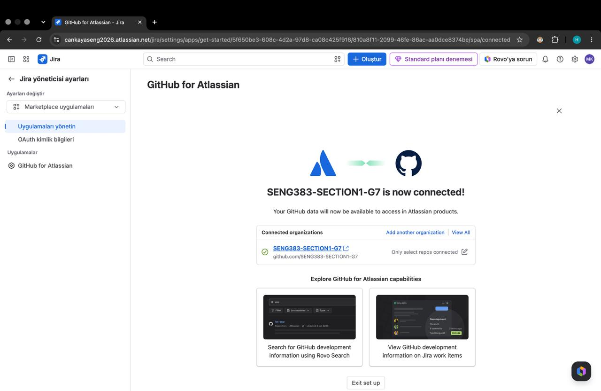

# Project Management Plan (PMP)

| Section | Content | Required by |
|---|---|---|
| PMP-1 | Project, Jira setup, team and roles | Week 6 |
| PMP-2 | Work packages (epics) and sprint plan | Week 6 |
| PMP-3 | Progress review: mid-term (v0.1) | Mid-term evaluation (Week 8 / 9) |
| PMP-4 | Progress review: v0.2 | Week 10 |
| PMP-5 | Progress review: final (v1.0) | Final evaluation |
| PMP-6 | Retrospective | Final evaluation |

---

## PMP-1. Project and Team

### Project and Jira Setup

**Project in one sentence:** A web-based decision support platform that brings parents, specialists and children together around one shared schedule, task list and record of observations, with a role-based AI summary that supports but never makes decisions.  
**Jira project key:** SSG123  
**Jira board link:** https://cankayaseng2026.atlassian.net/jira/software/projects/SSG123/boards/3  
**Connected GitHub repository:** https://github.com/SENG383-SECTION1-G7/SENG383-SECTION1-G7

### Team and Roles

| Name | Jira / GitHub username | Role |
|---|---|---|
| Muhammed Hamza Karamanlı | c2328036@student.cankaya.edu.tr / krmnlhmza | Developer |
| Efekan Erkafalı | c2328023@student.cankaya.edu.tr / c2328023 | Tester, Developer |
| Furkan Akarsu | c2328001@student.cankaya.edu.tr / fakarsu356 | Project Manager, Developer |

---

## PMP-2. Plan

### Work Packages (Epics)

### Work Packages (M1–M8)

| WP ID | Work Package Name | Requirements Covered | Owner | Number of Tasks | Planned Sprint |
| :--- | :--- | :--- | :--- | :---: | :---: |
| **M1** | Login and roles | FR-M1-01, FR-M1-02, FR-M1-03 | Hamza | 3 | Sprint 1 – Sprint 2 |
| **M2** | Linking specialists | FR-M2-01, FR-M2-02, FR-M2-03, FR-M2-04, FR-M2-05 | Hamza | 5 | Sprint 2 |
| **M3** | Weekly schedule | FR-M3-01, FR-M3-02, FR-M3-03 | Furkan | 3 | Sprint 2 |
| **M4** | Tasks | FR-M4-01, FR-M4-02, FR-M4-03 | Hamza | 3 | Sprint 3 |
| **M5** | Specialist entries | FR-M5-01, FR-M5-02, FR-M5-03 | Efekan | 3 | Sprint 3 |
| **M6** | Documents | FR-M6-01, FR-M6-02, FR-M6-03 | Furkan | 3 | Sprint 3 |
| **M7** | Weekly statistics | FR-M7-01, FR-M7-02 | Efekan | 2 | Sprint 4 |
| **M8** | Role-based AI summary | FR-M8-01, FR-M8-02, FR-M8-03, FR-M8-04 | Hamza | 4 | Sprint 4 |
### Sprint Plan

### Sprint Plan (Sprint 1–4)

| Sprint | Target Modules / Scope | Key Deliverables & Goals | Target Tag / Release |
| :--- | :--- | :--- | :--- |
| **Sprint 1** | Project Setup, SRS, SDD v1, PMP-1/2, Walking Skeleton (M1 Base & AI Mock) | `docs/SRS.md`, `docs/PMP.md` (PMP-1 & PMP-2), `docs/SDD.md` (v1), SQLite schema & seed, JWT Login API, Basic React Login UI, CI & Tests | `v0.0` (Walking Skeleton) |
| **Sprint 2** | **M1** (Role permissions), **M2** (Linking specialists), **M3** (Weekly schedule) | Role-based screen/API guards, Parent-Specialist linking/unlinking flow, Shared weekly schedule creation & view, Unit/Integration tests | `v0.1` |
| **Sprint 3** | **M4** (Tasks), **M5** (Specialist entries), **M6** (Documents) | Task assignment & completion flow, Specialist dated observations (with edit tracking), PDF/Image upload & access control, Tests | `v0.2` |
| **Sprint 4** | **M7** (Weekly statistics), **M8** (Role-based AI summary), Final Polish | Weekly task completion rates (total & by area), Gemini AI role-based summaries with feedback ("helpful"/"incorrect"), SDD v2, Final E2E Tests | `v1.0` (Final Release) |

---

## PMP-3. Progress Review: Mid-term (v0.1)

**Jira board screenshot:**  

| Epic | Planned for this point | Status (Done / In progress / Not started) |
|---|---|---|
| | | |
| | | |

**Changes to the plan (if any):**

---

## PMP-4. Progress Review: v0.2

**Jira board screenshot:**  

| Epic | Planned for this point | Status (Done / In progress / Not started) |
|---|---|---|
| | | |
| | | |

**Changes to the plan (if any):**

---

## PMP-5. Progress Review: Final (v1.0)

**Jira board screenshot:**  

| Epic | Planned for this point | Status (Done / In progress / Not started) |
|---|---|---|
| | | |
| | | |

**Changes to the plan (if any):**

---

## PMP-6. Retrospective

- What worked well in using Jira:
- What we would do differently:
