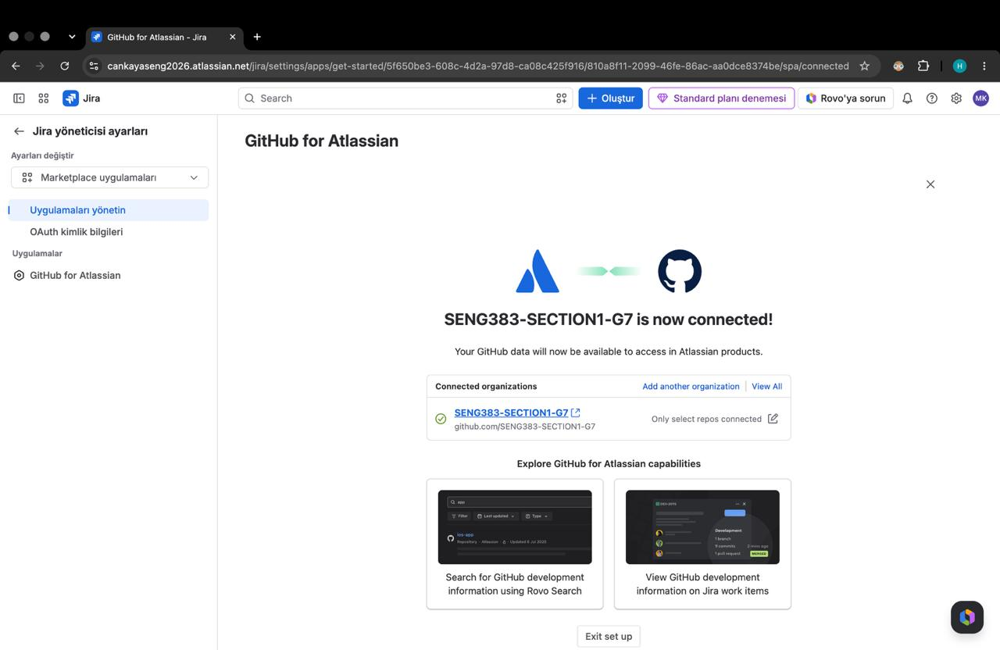
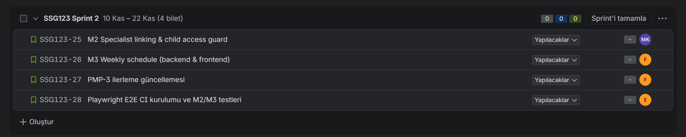

# Project Management Plan (PMP)

| Section | Content | Required by |
|---|---|---|
| PMP-1 | Project, Jira setup, team and roles | Week 6 |
| PMP-2 | Work packages (epics) and sprint plan | Week 6 |
| PMP-3 | Progress review: mid-term (v0.1) | Mid-term evaluation (Week 8 / 9) |
| PMP-4 | Progress review: v0.2 | Week 10 |
| PMP-5 | Progress review: final (v1.0) | Final evaluation |
| PMP-6 | Retrospective | Final evaluation |

---

## PMP-1. Project and Team

### Project and Jira Setup

**Project in one sentence:** A web-based decision support platform that brings parents, specialists and children together around one shared schedule, task list and record of observations, with a role-based AI summary that supports but never makes decisions.  
**Jira project key:** SSG123  
**Jira board link:** https://cankayaseng2026.atlassian.net/jira/software/projects/SSG123/boards/3  
**Connected GitHub repository:** https://github.com/SENG383-SECTION1-G7/SENG383-SECTION1-G7

### Team and Roles

| Name | Jira / GitHub username | Role |
|---|---|---|
| Muhammed Hamza Karamanlı | c2328036@student.cankaya.edu.tr / krmnlhmza | Developer |
| Efekan Erkafalı | c2328023@student.cankaya.edu.tr / c2328023 | Tester, Developer |
| Furkan Akarsu | c2328001@student.cankaya.edu.tr / fakarsu356 | Project Manager, Developer |

---

## PMP-2. Plan

### Work Packages (Epics)

### Work Packages (M1–M8)

| WP ID | Work Package Name | Requirements Covered | Owner | Number of Tasks | Planned Sprint |
| :--- | :--- | :--- | :--- | :---: | :---: |
| **M1** | Login and roles | FR-M1-01, FR-M1-02, FR-M1-03 | Hamza | 3 | Sprint 1 |
| **M2** | Linking specialists | FR-M2-01, FR-M2-02, FR-M2-03, FR-M2-04, FR-M2-05 | Hamza | 5 | Sprint 2 (v0.1) |
| **M3** | Weekly schedule | FR-M3-01, FR-M3-02, FR-M3-03 | Furkan | 3 | Sprint 2 (v0.1) |
| **M4** | Tasks | FR-M4-01, FR-M4-02, FR-M4-03 | Hamza | 3 | Sprint 2 (v0.1) |
| **M5** | Specialist entries | FR-M5-01, FR-M5-02, FR-M5-03 | Efekan | 3 | Sprint 3 (v0.2) |
| **M6** | Documents | FR-M6-01, FR-M6-02, FR-M6-03 | Furkan | 3 | Sprint 3 (v0.2) |
| **M7** | Weekly statistics | FR-M7-01, FR-M7-02 | Efekan | 2 | Sprint 3 (v0.2) |
| **M8** | Role-based AI summary | FR-M8-01, FR-M8-02, FR-M8-03, FR-M8-04 | Hamza | 4 | Sprint 3 (v0.2) |
### Sprint Plan

### Sprint Plan (Sprint 1–4)

| Sprint | Target Modules / Scope | Key Deliverables & Goals | Target Tag / Release |
| :--- | :--- | :--- | :--- |
| **Sprint 1** | Project Setup, SRS, SDD v1, PMP-1/2, Walking Skeleton (**M1** & AI Mock) | `docs/SRS.md`, `docs/PMP.md` (PMP-1 & PMP-2), `docs/SDD.md` (v1), SQLite schema & seed, JWT Login API, Basic React Login UI, CI & Tests | `v0.0` (Walking Skeleton) |
| **Sprint 2** | **M2** (Linking specialists), **M3** (Weekly schedule), **M4** (Tasks), PMP-3 | Parent-Specialist linking & child access guard, Weekly schedule API & UI, Task assignment & completion flow, First Playwright E2E test in CI | `v0.1` (Midterm Release) |
| **Sprint 3** | **M5** (Specialist entries), **M6** (Documents), **M7** (Weekly statistics), **M8** (Role-based AI summary) | Specialist dated observations, PDF/Image upload & access control, Weekly task completion statistics, Gemini AI role-based summaries with feedback | `v0.2` |
| **Sprint 4** | System Integration, Full E2E Test Suite, SDD v2, Final Polish | End-to-end regression testing, UI/UX refinements, SDD v2 finalization, Final presentation & release verification | `v1.0` (Final Release) |

---

## PMP-3. Progress Review: Mid-term (v0.1)

**Jira board screenshot:**  

| Epic / Module | Description | Target Release | Status | Notes / Progress |
| :--- | :--- | :---: | :---: | :--- |
| **PMP & Docs** | SRS, SDD v1, PMP-1, PMP-2, PMP-3 | v0.0 / v0.1 | Done | SRS, SDD v1, PMP-1/2 completed (`v0.0`); PMP-3 completed in Sprint 2 (`v0.1`). |
| **M1** | Login and roles (Walking Skeleton) | v0.0 | Done | Completed and merged in Sprint 1 (`v0.0` tag released). |
| **M2** | Linking specialists & child access guard | v0.1 | Done | Completed and merged in Sprint 2 (`SSG123-25`). |
| **M3** | Weekly schedule | v0.1 | Done | Completed and merged in Sprint 2 (`SSG123-26`). |
| **M4** | Tasks | v0.1 | Done | Completed in Sprint 2 (`SSG123-29`) to cover full `v0.1` Midterm release scope (`M1–M4`). |
| **M5** | Specialist entries | v0.2 | To Do | Planned for Sprint 3 (`v0.2`). |
| **M6** | Documents | v0.2 | To Do | Planned for Sprint 3 (`v0.2`). |
| **M7** | Weekly statistics | v0.2 | To Do | Moved to Sprint 3 (`v0.2`). |
| **M8** | Role-based AI summary | v0.2 | To Do | Base mock service created in `v0.0`; full feature planned for Sprint 3 (`v0.2`). |

**Changes to the plan (if any):** Sprint 1 (`v0.0` Walking Skeleton) was completed on schedule. In Sprint 2, work is focused on **M2** (`SSG123-25`), **M3** (`SSG123-26`), **PMP-3** (`SSG123-27`), and **E2E/M2–M3 tests** (`SSG123-28`) toward the `v0.1` midterm milestone.

---

## PMP-4. Progress Review: v0.2

**Jira board screenshot:**  

*(Sprint 3 board screenshot will be refreshed after Sprint 3 issues `SSG123-31`–`SSG123-34` are marked Done on Jira.)*

| Epic / Module | Planned for this point (`v0.2`) | Status | Notes / Progress |
| :--- | :--- | :---: | :--- |
| **PMP & Docs** | PMP-4 Progress Review | Done | Updated in Week 9 (`SSG123-31`) ahead of `v0.2` release. |
| **M1** | Login and roles | Done | Completed in `v0.0` and verified in `v0.1` midterm live demo. |
| **M2** | Linking specialists & child access guard | Done | Completed in `v0.1` (`SSG123-25`). |
| **M3** | Weekly schedule | Done | Completed in `v0.1` (`SSG123-26`). |
| **M4** | Tasks (assignment & child completion) | Done | Completed in `v0.1` (`SSG123-29`, `SSG123-30`) and tagged `v0.1`. |
| **M5** | Specialist entries (dated observations & edited mark) | In Progress | Scheduled for Sprint 3 (`SSG123-32`). |
| **M6** | Documents (PDF/image upload & download) | In Progress | Scheduled for Sprint 3 (`SSG123-32`). |
| **M7** | Weekly statistics (total & by development area) | In Progress | Scheduled for Sprint 3 (`SSG123-33`). |
| **M8** | Role-based AI summary (persistence, source links & feedback) | In Progress | Scheduled for Sprint 3 (`SSG123-33`). |
| **Testing & CI** | Branch coverage ≥ 40% & 3 critical E2E flows in Playwright | In Progress | Scheduled for Sprint 3 (`SSG123-34`); server branch coverage already > 65%. |

**Changes to the plan (if any):** `Release v0.1 (M1–M4)` was completed and tagged on schedule after the Week 8 live demo. Sprint 3 focuses on delivering **M5–M8** (`SSG123-32`, `SSG123-33`) and the 3 critical Playwright E2E flows (`SSG123-34`) for the Week 10 `v0.2` milestone.

---

## PMP-5. Progress Review: Final (v1.0)

**Jira board screenshot:**  

| Epic / Module | Planned for Final (`v1.0`) | Status | Notes / Progress |
| :--- | :--- | :---: | :--- |
| **PMP & Docs** | SRS, SDD Final, PMP-1..PMP-6, Final Report | Done | All documentation finalized (`SSG123-36`, `SSG123-37`). |
| **M1** | Login and roles | Done | JWT authentication & role isolation verified in unit & E2E tests. |
| **M2** | Linking specialists & child access guard | Done | Parent links/unlinks specialists; `authorizeChildAccess` enforces 403 for unlinked users. |
| **M3** | Weekly schedule | Done | Shared weekly events API & UI (`SSG123-26`). |
| **M4** | Tasks | Done | Task assignment by parent/specialist & completion by child (`SSG123-29`, `SSG123-30`). |
| **M5** | Specialist entries | Done | Dated observations, author-only editing with `edited` badge, blocked for child (`SSG123-32`). |
| **M6** | Documents | Done | Validated PDF/image upload & authorized download, blocked for child (`SSG123-32`). |
| **M7** | Weekly statistics | Done | Total and per-area task completion rates (`SSG123-33`). |
| **M8** | Role-based AI summary | Done | Separate parent/specialist prompts, `AI-generated` label, source links & `helpful`/`incorrect` feedback (`SSG123-33`). |
| **Testing & CI** | Branch coverage ≥ 60% & E2E test for each of M1–M8 | Done | Server branch coverage **65.68%** (32 Jest tests), 14 Vitest tests, and full Playwright E2E suite for M1–M8 (`SSG123-35`). |

**Changes to the plan (if any):** All eight mandatory modules (`M1–M8`), full `M1–M8` Playwright E2E tests, SDD Final, PMP-5/6, and Final Report were completed ahead of the Week 12 deadline for `Release v1.0`.

---

## PMP-6. Retrospective

- **What worked well in using Jira:**
  - Linking every GitHub branch and Pull Request directly to a Jira issue key (`SSG123-17` through `SSG123-37`) provided full traceability from requirements to code and tests.
  - Breaking work into incremental releases (`v0.0` Walking Skeleton → `v0.1` M1–M4 → `v0.2` M5–M8 → `v1.0` Final) kept PRs small, reviewable, and continuously verified by GitHub Actions CI.
  - Enforcing branch protection (PR + peer approval + green Jest/Vitest/Playwright CI) prevented broken builds from ever reaching `main`.
- **What we would do differently:**
  - Update Jira issue statuses (`In Progress` / `Done`) immediately when merging PRs so completed sprint items do not roll over into the next sprint.
  - Agree earlier on exact API response shapes and test selectors before parallel frontend/backend work to avoid small CI selector adjustments.
