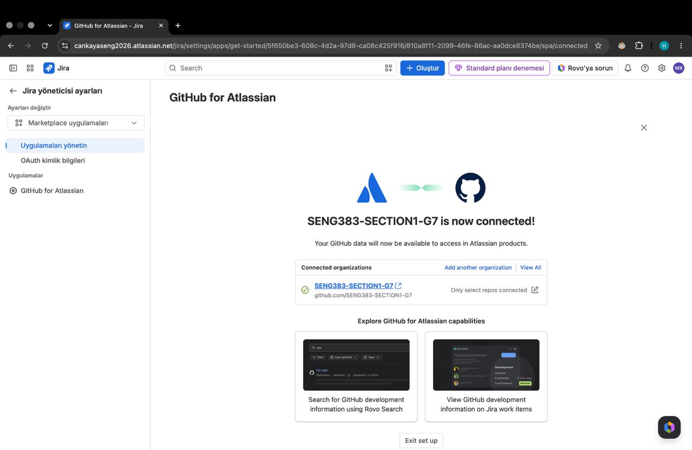

# Project Management Plan (PMP)

| Section | Content | Required by |
|---|---|---|
| PMP-1 | Project, Jira setup, team and roles | Week 6 |
| PMP-2 | Work packages (epics) and sprint plan | Week 6 |
| PMP-3 | Progress review: mid-term (v0.1) | Mid-term evaluation (Week 8 / 9) |
| PMP-4 | Progress review: v0.2 | Week 10 |
| PMP-5 | Progress review: final (v1.0) | Final evaluation |
| PMP-6 | Retrospective | Final evaluation |

---

## PMP-1. Project and Team

### Project and Jira Setup

**Project in one sentence:** A web-based decision support platform that brings parents, specialists and children together around one shared schedule, task list and record of observations, with a role-based AI summary that supports but never makes decisions.  
**Jira project key:** SSG123  
**Jira board link:** https://cankayaseng2026.atlassian.net/jira/software/projects/SSG123/boards/3  
**Connected GitHub repository:** https://github.com/krmnlhmza/SENG383-SECTION1-G7  

### Team and Roles

| Name | Jira / GitHub username | Role |
|---|---|---|
| Muhammed Hamza Karamanlı | c2328036@student.cankaya.edu.tr / krmnlhmza | Developer |
| Efekan Erkafalı | c2328023@student.cankaya.edu.tr / c2328023 | Tester, Developer |
| Furkan Akarsu | c2328001@student.cankaya.edu.tr / fakarsu356 | Project Manager, Developer |

---

## PMP-2. Plan

### Work Packages (Epics)

| Epic | Owner | Number of tasks | Planned sprint(s) |
|---|---|---|---|
| M1 | | | |
| M2 | | | |
| M3 | | | |
| M4 | | | |
| M5 | | | |
| M6 | | | |
| M7 | | | |
| M8 | | | |

### Sprint Plan

| Sprint | Weeks | Sprint goal | Ends with |
|---|---|---|---|
| Sprint 1 | | | Walking skeleton (v0.0), Week 6 |
| Sprint 2 | | | Release v0.1, mid-term |
| Sprint 3 | | | Release v0.2, Week 10 |
| Sprint 4 | | | Release v1.0, final |

---

## PMP-3. Progress Review: Mid-term (v0.1)

**Jira board screenshot:**  

| Epic | Planned for this point | Status (Done / In progress / Not started) |
|---|---|---|
| | | |
| | | |

**Changes to the plan (if any):**

---

## PMP-4. Progress Review: v0.2

**Jira board screenshot:**  

| Epic | Planned for this point | Status (Done / In progress / Not started) |
|---|---|---|
| | | |
| | | |

**Changes to the plan (if any):**

---

## PMP-5. Progress Review: Final (v1.0)

**Jira board screenshot:**  

| Epic | Planned for this point | Status (Done / In progress / Not started) |
|---|---|---|
| | | |
| | | |

**Changes to the plan (if any):**

---

## PMP-6. Retrospective

- What worked well in using Jira:
- What we would do differently:
