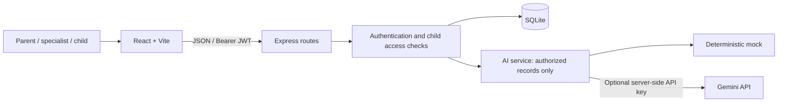
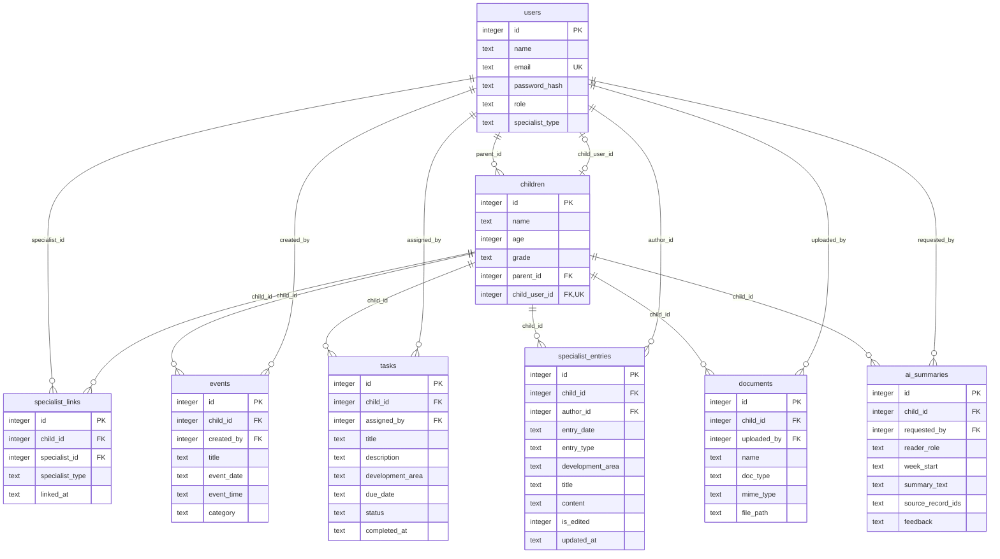
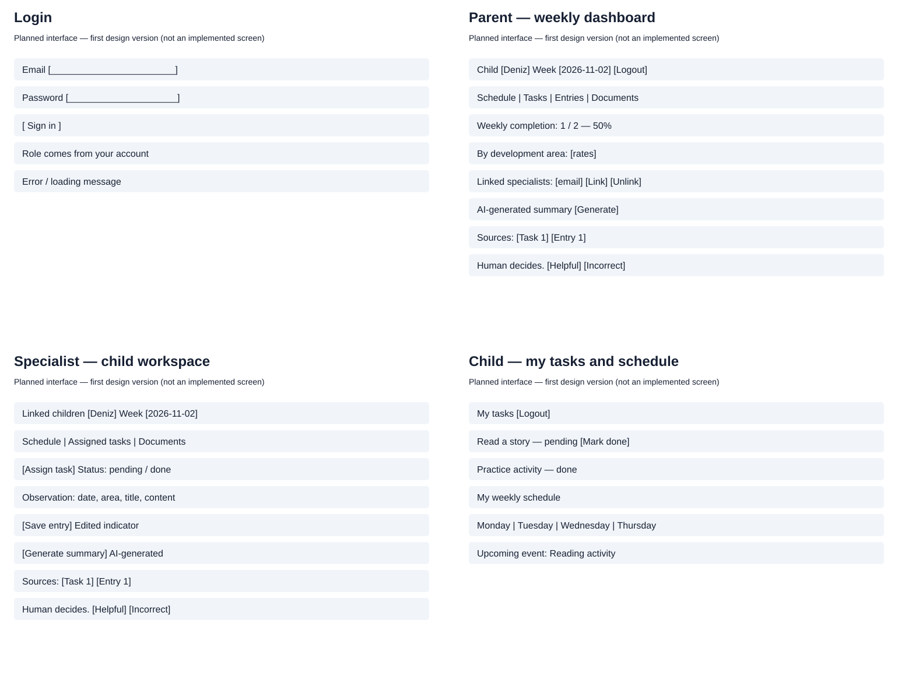

# Software Design Document (SDD)

**Team name:** SENG383-SECTION1-G7  
**Version:** ☒ First version (Week 6) ☐ Final (Week 10)  
**Last updated:** 2026-11-04

This first design version traces the requirements in `SRS.md` to the walking skeleton and the planned M1–M8 implementation. **Implemented** means present in the SSG123-22 skeleton; **planned** means a design contract for later increments, not an available feature. SSG123-24 adds automated checks and mandatory test-mode AI isolation.

## 1. Architecture Overview

The application is a local client–server system: a React frontend calls an Express REST API, which authenticates users and accesses SQLite through parameterized queries. A single backend AI service selects deterministic mock responses or Gemini; credentials and database access stay on the server. Every child-data operation must authorize the current parent, linked specialist or child before reading data.



### Technology Stack

| Layer | Technology |
|---|---|
| Frontend | React, Vite; token and screen state in React memory |
| Backend | Node.js 20, Express, jsonwebtoken, bcryptjs |
| Database | SQLite via better-sqlite3; foreign keys enabled |
| Testing | Jest + Supertest (API/service), Vitest + Testing Library (UI); Playwright planned for end-to-end flows |
| CI | GitHub Actions: server tests, client tests and production build |

Local execution follows README install, seed and dev commands. Only synthetic seed data is permitted. There is no Docker or cloud deployment. Logout clears client token/account/summary state; refreshing requires login again. JWT lifetime is eight hours; logout does not revoke an already issued token server-side.

## 2. Module Design

| Module | Main components | Implements requirements |
|---|---|---|
| M1 | Implemented: `App.jsx` login and role views; `routes/auth.js`, `middleware/auth.js`; bcrypt password verification and account-derived JWT role. Screen coverage grows with later modules. | FR-M1-01, FR-M1-02, FR-M1-03 |
| M2 | Implemented: `specialist_links` table and current-link check for AI preview. Planned: specialist linking/list/unlink UI and shared per-child access guard for every data route. | FR-M2-01–FR-M2-05 |
| M3 | Implemented: `events` schema and synthetic event. Planned: weekly calendar and event create/list handlers. | FR-M3-01–FR-M3-03 |
| M4 | Implemented: `tasks` schema and synthetic pending/done tasks. Planned: task assignment form, own-task list/completion action and assigner view. | FR-M4-01–FR-M4-03 |
| M5 | Implemented: `specialist_entries` schema and seed observation. Planned: entry editor/list, author ownership check and edited indicator. | FR-M5-01–FR-M5-03 |
| M6 | Implemented: `documents` metadata schema. Planned: validated upload, private file storage and authorized list/view/download handlers. | FR-M6-01–FR-M6-03 |
| M7 | Planned: statistics query/service and weekly dashboard, using task due dates and completion status. | FR-M7-01, FR-M7-02 |
| M8 | Implemented: `routes/ai.js`, `services/aiService.js`, role prompts and mock preview. Planned: selected-week filtering, source links, summary persistence and feedback UI/API. | FR-M8-01–FR-M8-04 |

### Access and validation design

A valid JWT identifies the user; it does not establish access to a requested child. The planned shared guard checks `children.parent_id`, a current `specialist_links` row or `children.child_user_id`, as appropriate. Every nested record is also checked against the authorized child. Unlinking removes access on the next request, including download and summary-source requests; cached client data is cleared when access is rejected.

Child users may read only their own schedule/tasks and complete their own tasks. They cannot read entries, documents, statistics or summaries, or assign tasks. Only the parent links/unlinks specialists. Linked specialists and parents read all records for that child; observation edits are limited to the author in the proposed contract. SQL foreign keys alone do not enforce these role rules.

### AI safety and mock design

`generateRoleSummary({role, childName, records})` is the only provider boundary. The backend selects authorized records before calling it; the frontend cannot supply a different reader role or arbitrary records. Parent and specialist prompts differ, and instruct the provider not to diagnose, prescribe treatment or make decisions. Returned source references are constructed from the authorized input, not invented by the model.

Mock mode is the default and needs no API key. SSG123-24 forces mock when `NODE_ENV=test`, even if `AI_MODE=gemini` is inherited, and explicitly sets `AI_MODE=mock` in CI. Tests assert that no provider request occurs. Real provider use is optional and limited to synthetic data.

Prompt instructions alone cannot guarantee NFR-03. Before completing M8, add a bounded provider timeout, safe generic errors, rejection of empty/unsafe responses and a human-review notice. Treat record text as untrusted data, not instructions; never automatically execute model output or use it to change records. Safety review and adversarial tests remain release work, not a claimed skeleton capability.

## 3. Data Model

The following names match `server/src/db.js`. All tables use an integer `id` primary key; child-scoped rows reference `children.id`. Dates/timestamps are stored as text; application validation must enforce ISO date/time formats.



`created_at` timestamps exist on all tables except `specialist_links`, which has `linked_at`. Email is unique; `(child_id, specialist_id)` is unique. Roles are constrained to parent/specialist/child, task status to pending/done, summary reader role to parent/specialist and feedback to helpful/incorrect (or null). Child deletion cascades to child-scoped rows; deleting a child login sets `child_user_id` to null. File deletion/retention requires application handling; SQL cascades do not delete files.

Planned summary persistence serializes typed source references (type and ID) into `source_record_ids` as JSON text, avoiding collisions between task and entry IDs. Documents store private local paths; paths are never directly exposed as public URLs. Upload validation must check both extension and actual media type, generate server-side filenames and prevent path traversal. The first implementation will use a documented size limit and reject unsupported/oversized files.

## 4. API / Interfaces

### Implemented skeleton endpoints

| Method | Endpoint | Description | Module |
|---|---|---|---|
| GET | `/api/health` | Public health response | Infrastructure |
| POST | `/api/auth/login` | Email/password → JWT and safe user fields; 400 missing fields, 401 invalid credentials | M1 |
| GET | `/api/auth/me` | Bearer JWT → current database user; 401 invalid/expired token, 404 missing account | M1 |
| GET | `/api/ai/preview` | Parent or linked specialist → first accessible child's task/entry preview; 403 child/unlinked specialist, 404 parent without child | M8 skeleton |

Login normalizes email and obtains the role from the account, ignoring a submitted role. Password hashes are never returned. Preview returns `{label, mode, role, summary, sourceRecords}` with source entries `{id, type, title, date}`. It currently has no week selector, persistence or feedback endpoint and displays only a source count in the UI; it does not yet fulfill the complete M8 acceptance criteria.

The public health endpoint is a known exception to SRS NFR-01's wording (“every API route except login”). This first design records the discrepancy; the team must reconcile the SRS or protect health before claiming full NFR-01 compliance.

### Proposed contracts for later increments

These routes are design proposals for team review; they are **not implemented by the walking skeleton**. All require a JWT and the per-child/record access check described above.

| Method | Endpoint | Description | Module |
|---|---|---|---|
| GET | `/api/children` | List only accessible child profiles | M2 |
| GET / POST | `/api/children/:childId/specialists` | Parent lists links or links registered specialist by email/type | M2 |
| DELETE | `/api/children/:childId/specialists/:specialistId` | Parent confirms unlink; 204 on success | M2 |
| GET / POST | `/api/children/:childId/events` | List selected week; parent/linked specialist creates title/date/time | M3 |
| GET / POST | `/api/children/:childId/tasks` | Authorized list; parent/linked specialist assigns title/description/area/due date | M4 |
| PATCH | `/api/children/:childId/tasks/:taskId` | Own child marks done; backend sets completion timestamp | M4 |
| GET / POST | `/api/children/:childId/entries` | Parent/linked specialist reads; linked specialist creates observation | M5 |
| PATCH | `/api/children/:childId/entries/:entryId` | Linked author edits; sets is_edited and updated_at | M5 |
| GET / POST | `/api/children/:childId/documents` | Parent/linked specialist lists metadata or uploads multipart file | M6 |
| GET | `/api/children/:childId/documents/:documentId/download` | Authorized streaming of PDF/image; child denied | M6 |
| GET | `/api/children/:childId/statistics` | Authorized adult reads completion totals and per-area results | M7 |
| POST | `/api/children/:childId/summaries` | Parent/linked specialist generates selected-week summary | M8 |
| PATCH | `/api/children/:childId/summaries/:summaryId/feedback` | Authorized requesting reader supplies helpful/incorrect | M8 |

Weekly list/statistics queries use `weekStart=YYYY-MM-DD` (Monday); summary requests carry `weekStart` in JSON. The proposed interval is inclusive Monday through exclusive next Monday, using local calendar dates. Events use event_date, tasks due_date and entries entry_date. Completion rate = done tasks due in that week / all tasks due in that week × 100; no tasks yields 0% with an explicit “no tasks” state. Historical rates reflect current task status, not a snapshot at the week boundary.

Proposed error contract is `{error: string}`: 400 invalid input, 401 missing/invalid token, 403 unauthorized role/link, 404 missing authorized resource, 409 duplicate link, 413 oversized file, 415 unsupported media type and 502/504 provider failure/timeout. Create operations return 201. UI maps errors to useful messages without exposing SQL, secrets or internal paths.

## 5. Critical Flows

These are the same three flows as SRS section 4. The diagrams describe the target design; the skeleton implements login and a limited AI preview, not these complete end-to-end flows.

### Flow 1: Linking a specialist

Requirements: FR-M2-01, FR-M2-04, FR-M2-05.

```mermaid
sequenceDiagram
  actor Parent
  actor Specialist
  participant UI as React
  participant API as Express
  participant DB as SQLite
  Parent->>UI: Enter registered specialist email/type
  UI->>API: POST child specialists + JWT
  API->>DB: Verify parent ownership and specialist account
  alt Valid registered specialist
    API->>DB: Insert unique specialist link
    API-->>UI: 201 linked
  else Invalid email or duplicate link
    API-->>UI: 400 or 409
  end
  Specialist->>API: Request child's records + JWT
  API->>DB: Check current specialist link
  API-->>Specialist: Authorized records while linked
  Parent->>UI: Confirm unlink
  UI->>API: DELETE specialist link + JWT
  API->>DB: Verify ownership and delete link
  API-->>UI: 204
  Specialist->>API: Request child's records with same JWT
  API->>DB: Recheck current link
  API-->>Specialist: 403; no child data
```

Test plan: link, read, unlink and repeat requests to each child-data route. The SSG123-24 API test already checks immediate denial of AI preview after deleting the link; the full linking UI/API flow is future Playwright coverage.

### Flow 2: Task assignment and completion

Requirements: FR-M4-01, FR-M4-02, FR-M4-03, FR-M7-01.

```mermaid
sequenceDiagram
  actor Specialist
  actor Child
  participant UI as React
  participant API as Express
  participant DB as SQLite
  Specialist->>UI: Fill task assignment form
  UI->>API: POST child tasks + specialist JWT
  API->>DB: Verify link; insert pending task
  API-->>UI: 201 task
  Child->>UI: Open own tasks
  UI->>API: GET own child tasks + child JWT
  API->>DB: Verify child_user_id; select tasks
  API-->>UI: Own task list
  Child->>UI: Mark task done
  UI->>API: PATCH task status done
  API->>DB: Verify task ownership; update status/completed_at
  API-->>UI: Updated task
  Specialist->>UI: Refresh assigned tasks and selected week
  UI->>API: GET tasks and statistics
  API->>DB: Verify current link; query status and rates
  API-->>UI: Done status; updated completion rate
```

Test plan: reject another child's completion request, make repeated completion idempotent, and compare total/per-area rates before and after completion, including the zero-task case.

### Flow 3: Role-based AI summary

Requirements: FR-M8-01, FR-M8-02; also FR-M8-03 and NFR-04.

```mermaid
sequenceDiagram
  actor Reader as Parent or linked specialist
  participant UI as React
  participant API as Express
  participant DB as SQLite
  participant AI as Single AI service
  Reader->>UI: Select child/week and request summary
  UI->>API: POST summaries + JWT and weekStart
  API->>DB: Verify ownership/current link; select week's authorized records
  API->>AI: Account role and filtered records
  AI->>AI: Select role prompt and mock mode
  AI-->>API: AI-generated summary and typed source references
  API->>DB: Store summary, role, week and source references
  API-->>UI: Summary and source references
  UI-->>Reader: AI-generated label, human-decision notice and source links
  Reader->>UI: Open source record
  UI->>API: GET source with JWT
  API->>DB: Recheck current access
  API-->>UI: Authorized source or 403 after unlink
```

Test plan: fixed mock inputs produce deterministic role-specific output without network calls; exclude other families and weeks; child/unlinked specialist denied; rendered source links open only authorized records. Weekly filtering, persistence and clickable sources are still planned.

## 6. User Interface

The sketches below describe planned screens, not screenshots of completed features. The skeleton currently supplies email/password login, demo account buttons, role-specific headings, logout and an adult-only AI preview.

| Screen | Image | Module |
|---|---|---|
| Login | [Login sketch](img/screens.svg) | M1 |
| Parent weekly dashboard and specialist links | [Parent sketch](img/screens.svg) | M2, M3, M4, M5, M6, M7, M8 |
| Specialist child workspace | [Specialist sketch](img/screens.svg) | M2, M3, M4, M5, M6, M8 |
| Child tasks and schedule | [Child sketch](img/screens.svg) | M3, M4 |



Forms display validation and request errors; pending submissions are disabled. Specialist unlink requires confirmation. Child screens expose no entries, documents or AI controls. Summary output includes “AI-generated”, a human-decision notice, authorized source links and helpful/incorrect feedback in the planned M8 UI. Hiding controls complements, and never replaces, API authorization.

## 7. Change Log

| Date | Change | By |
|---|---|---|
| 2026-11-04 | First version using course SDD template: architecture, M1–M8 traceability, actual SQLite schema, implemented/proposed API contracts, three SRS flows, AI/mock design and UI sketches. | Efekan Erkafalı |
